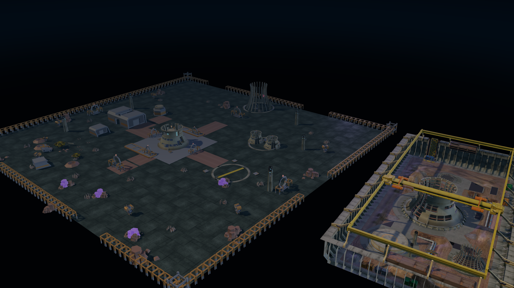
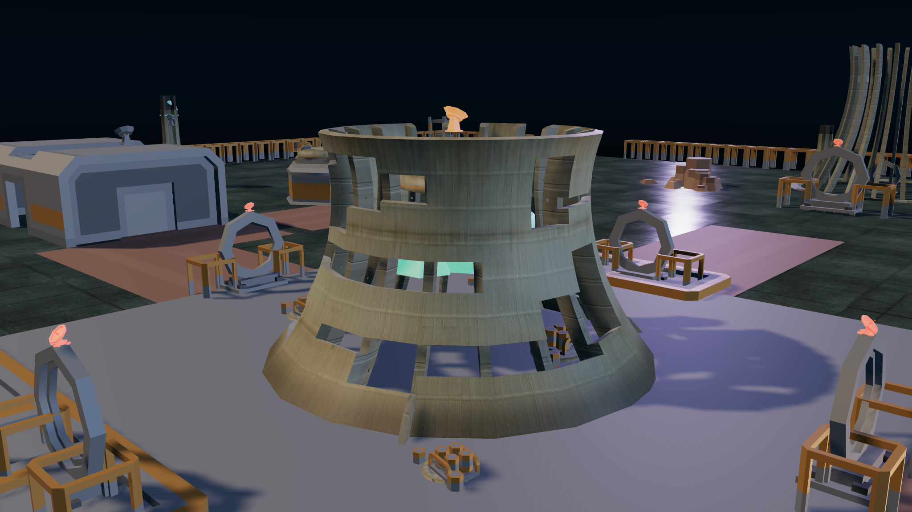
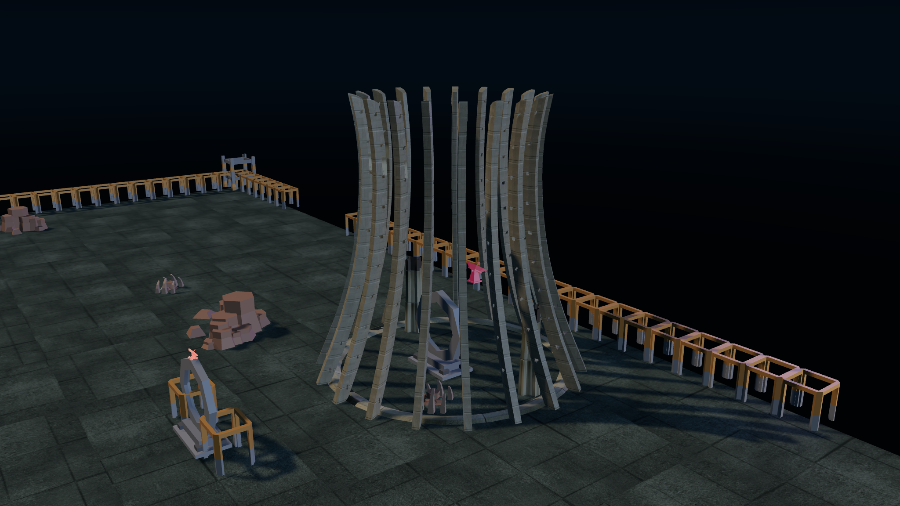
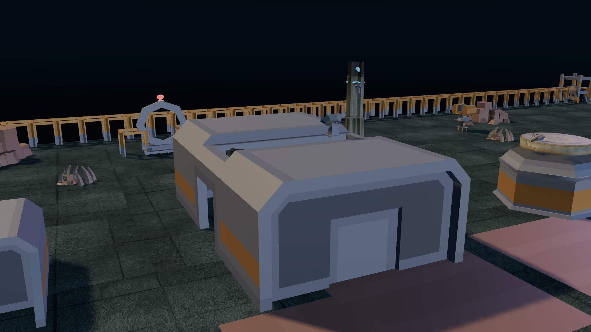
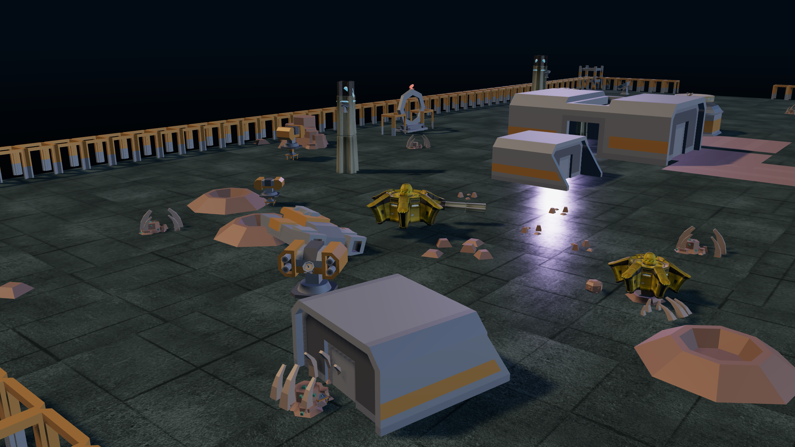

# NEON FRONTIER — "Frontier Outpost"

The single world this branch builds. One place, 192 × 180 m, wholly walkable, every
asset in it a real licensed GLB — no geometry in this world is generated by code.

---

## 1. The place

A frontier outpost of the Exocomplict corporation, built around the reactor that
keeps it alive, on a shelf of black basalt at the edge of an alien night. The
outpost is not ruined and it is not finished: it is **holding**, and the reason it
is holding is the reactor in the middle of the arena.

Everything radiates from that reactor. Roads leave it in four directions, the
settlement sits on its west side like a lean-to against a furnace, the energy bank
taps it from the east, the docking gate north of it is the way off this rock, and
south of it the planet is taking the place back — a crashed transport, a dead
alien drone, and crystals growing through the cracks in the pavement.

The player never leaves the map. There is no loading screen between districts,
because there are no districts in the technical sense: it is one continuous
surface with a navmesh-friendly 0.2 m deck at the centre and a 2.6 m perimeter
wall that exists to frame the playfield, not to stop the player.

*`overview` — the whole world from 186, 108, 148. Arena deck at the centre, outpost
to the west, extraction bank to the east, docking gate north, crashed sector
south, and the Cinder Yard power station standing outside the east wall. Rendered
from the live scene graph at 2048 × 1152.*

## 2. The five beats

| Beat | Where | What it is for |
| --- | --- | --- |
| **Arena** | centre, 38 × 38 m deck | Wave combat around the reactor; four wave-entry gates on the deck's cardinals and four cover modules for line-of-fire breaks. |
| **Outpost** | west | Friendly ground: command centre, research lab, equipment depot, two sensor towers, the landing platform on the east deck. Vendors, upgrades, respawn. |
| **Extraction** | east | The generator bank and its pipe run — an industrial, exposed-brass counterweight to the outpost's clean panels. |
| **Docking gate** | north | An 11 m colossal gate on the far end of a raised causeway. The horizon landmark you can navigate by. |
| **Crashed sector** | south | Wreckage, crystals, luminous flora. Low cover, harvestable colour, and the only place in the world where the palette goes green. |

## 3. Why it looks like this

The palette is nine tokens — near-black voids, graphite panels with a cool
hairline, and exactly three luminous colours: **amber** (warning and heat),
**cyan** (power and information) and **violet** (alien). Nothing is bright by
accident. A surface is either structure (low saturation, matte) or energy (fully
saturated, emissive); there is no third category, which is what keeps a night
scene readable at mobile brightness.

Three lighting rules, applied by `src/worlds/neon_frontier.js → worldLighting()`:

1. One warm key from the south-west, low enough to throw 20–30 m shadows.
2. One cyan fill from the east, at half the key's intensity, marking the edges
   that face away from the key.
3. One violet rim from the north — the alien colour arrives from the direction of
   the docked wreck, so the light itself tells you where the danger is.

The sky is a shader gradient with a single bright haze band just above the
horizon. That band is deliberate: a night scene needs one soft edge to separate
silhouettes from the backdrop, or the skyline disappears into the fog.

## 4. The world moves

A static outpost reads as a diorama. Every district therefore has at least two
moving parts, authored as animation clips on the real meshes:

- **Reactor**: the two tank-ring collars counter-rotate at 0.32 and −0.26 rad/s,
  the crystal core pulses on a 2.6 s breath and the crown dish turns continuously.
- **Settlement**: the command dish scans a full turn every 14 s, the lab's sample
  vessel spins and its dome turns, depot crates bob.
- **Perimeter**: six turrets sweep their yaw housings out of phase, five sensor
  towers spin their dishes at 1.3 rad/s and sweep a second dish slower.
- **Extraction**: both generator shells pulse out of phase, their stacks
  counter-rotate, the concrete pad carries the whole assembly.
- **Boss gate**: the 20 m rib cage breathes at 1.4 s, the lock frame pulses, the
  sentry dish turns.
- **Crashed sector**: hulls sway, crystals pulse in violet, nineteen flora sway on
  their own phase, the landing gantry bobs.

That is **119 clips** driven by one `AnimationMixer` in the viewer and exported as
119 glTF animations inside `world.glb`. Clip tracks are named
`<Instance>__<Part>`, so five identical sensor towers animate independently, and
the gate fails the build if a rule targets a part that does not exist.

### The captures

| | |
| --- | --- |
|  |  |
| `arena` — reactor, hazard ring, wave gates, cover | `boss` — the 11 m docking gate on its causeway |
|  |  |
| `outpost` — command centre, depot, sensor tower | `wilds` — wrecks, crystals, flora, cracked pavement |

The full asset inventory is [`ASSET_LIST.md`](ASSET_LIST.md); the surface and
verification record is [`PBR_AND_VERIFICATION.md`](PBR_AND_VERIFICATION.md).

## 5. How you verify it

Not by trusting the code. Three independent gates, described in
[`PBR_AND_VERIFICATION.md`](PBR_AND_VERIFICATION.md):

1. **Provenance ledger** — every file's SHA-256 against its licence and upstream
   URL; a `.glb` in the folder with no entry fails the check.
2. **World renders** — nine authored cameras, rendered from the live scene graph in
   pinned headless Chromium at 2048 × 1152. The same run fails if a single mesh in
   the scene did not come from a real GLB.
3. **Engine import** — the assembled world is imported into Godot in CI, measured
   against the staged manifest, and its clips and spawn sockets are checked.
