# NEON FRONTIER — three worlds, three missions

This branch builds **three worlds**, one per mission. Each is a complete,
wholly walkable place in which every visible asset is a real, licensed GLB — no
geometry in any of them is generated by code.

| World | Mission | Field | Geometry | Motion |
| --- | --- | --- | --- | --- |
| **Frostline Relay** | defence | 168 × 156 m | 113,086 tris · 36 instances · 35 GLBs | 61 clips |
| **Verdant Bloom** | recovery | 176 × 164 m | 128,182 tris · 92 instances · 44 GLBs | 156 clips |
| **Emberfall Foundry** | extraction | 200 × 176 m | 227,811 tris · 31 instances · 29 GLBs | 31 clips |

The worlds are told apart by three things, in this order: **what is standing
there** (a relay array, a bloom, a foundry), **how it is lit** (polar cyan, hot
green under a canopy, furnace orange against a violet rim), and **what the
mission asks** (hold, recover, extract). Everything else — the builder, the
verification gates, the placement rules — is shared on purpose.

---

## 1. Frostline Relay — hold the uplink

A polar relay station holding the last uplink on a frozen shelf. Air you can see,
white ice, cyan light, and hardware that has been outside too long.

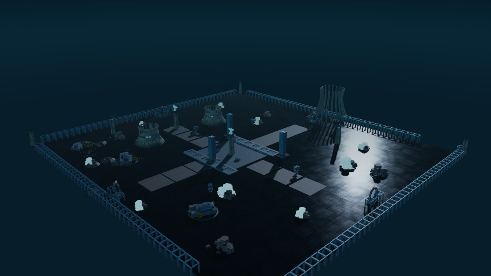

*`overview` — the field from above. Uplink core at the centre, the relay station
to the west, the turret line on the north and south approaches, the icefield with
its frozen haulers and crystal spires, and the polar gate at the north end.*

| Beat | Where | What it is for |
| --- | --- | --- |
| **Uplink core** | centre | A comms array on its pad, ringed by relay masts. The arena: nothing here blocks the player, everything here turns. |
| **Relay station** | west | Cryo condensers, a station dish, a sensor tower. The friendly ground. |
| **Defence line** | north / south | Four turrets flanking the two approach lanes, four breach gates the waves come through. |
| **Icefield** | east / south | Frozen haulers, ice spires, shattered rock. Low cover and the world's only warm accent. |
| **Polar gate** | north end | A 12 m arch on the causeway: the horizon landmark you navigate by. |

| | |
| --- | --- |
| 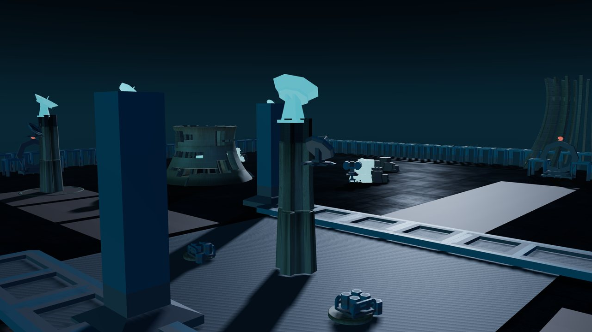 | 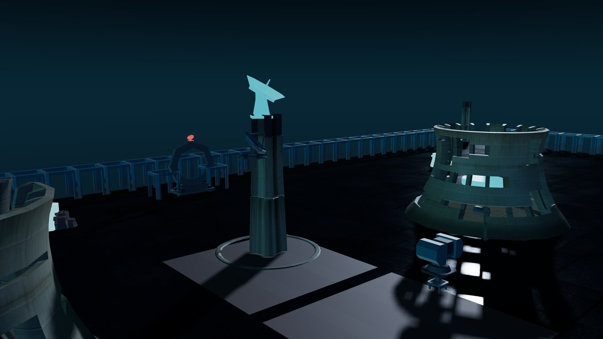 |
| `core` — the uplink array and its masts | `station` — cryo condensers, dish, sensor tower |
| 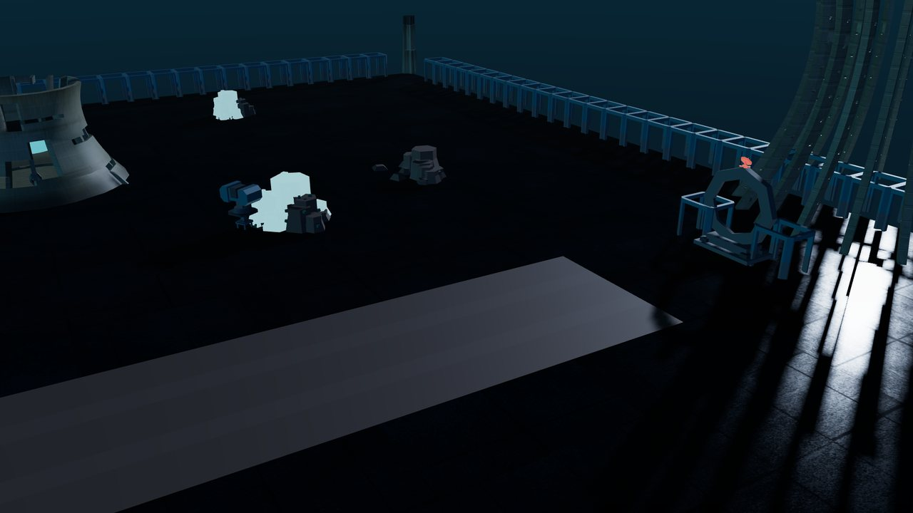 | 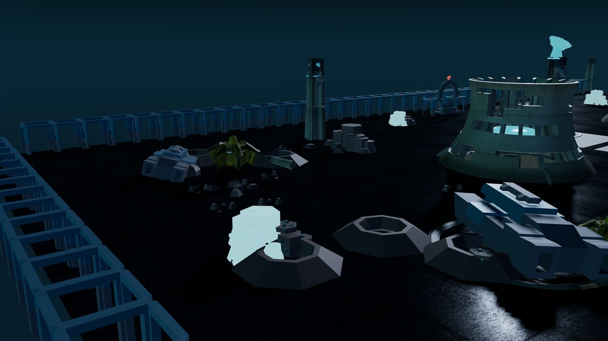 |
| `defence` — turret line and breach gate | `icefield` — frozen hauler, ice spires, shattered rock |

## 2. Verdant Bloom — bring back what is still readable

A research bloom that outgrew its own station. The corridors are arch ribs with
moss on them, the domes have trees growing through the roof, and a scout drone has
been sitting in the undergrowth long enough to be part of it.

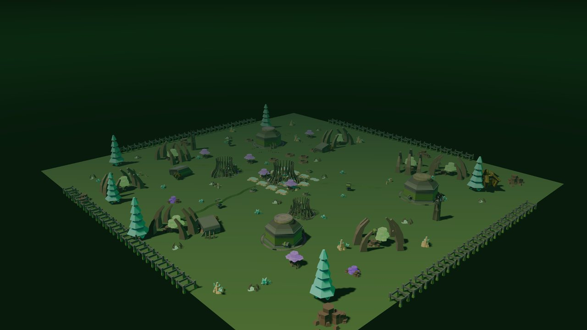

*`overview` — bio domes and giant flora under a warm canopy sun, real Kenney pines
and undergrowth filling the gaps between the station's own architecture.*

| Beat | Where | What it is for |
| --- | --- | --- |
| **Seed vault** | centre | The overgrown arch the whole layout is composed around; the recovery team's objective sits under it. |
| **Bio domes** | west | Three domes with real canopy growing through them. Bright, green, safe. |
| **Grove** | east | Forty-odd Nature Kit trees, bushes, moss drapes and mushroom rings — a real forest, not a scatter field. |
| **Nursery** | north | Spore vents and giant flora; the ground that fights back. |
| **The wreck** | south | The crashed lab and its drone in a crater, rimmed by lantern flora. |

| | |
| --- | --- |
| 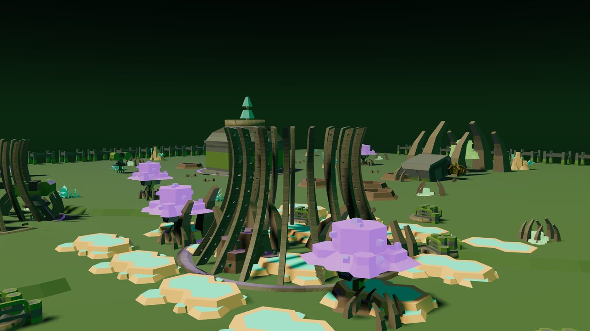 | 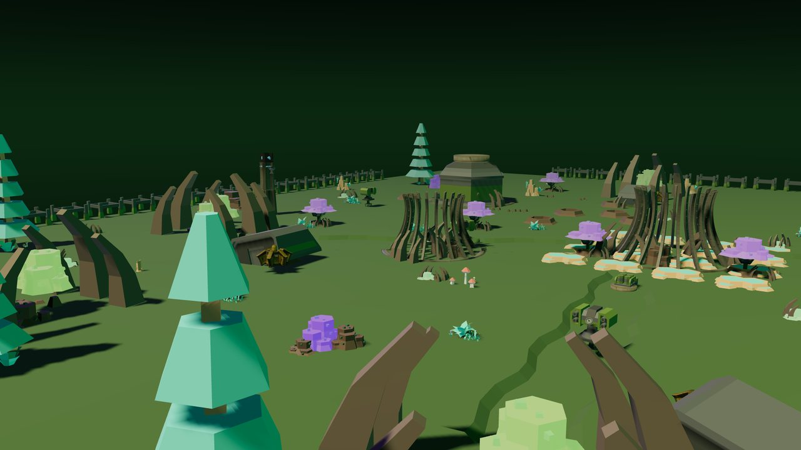 |
| `shrine` — the seed vault arch | `grove` — real pines, moss, mushroom rings |
| 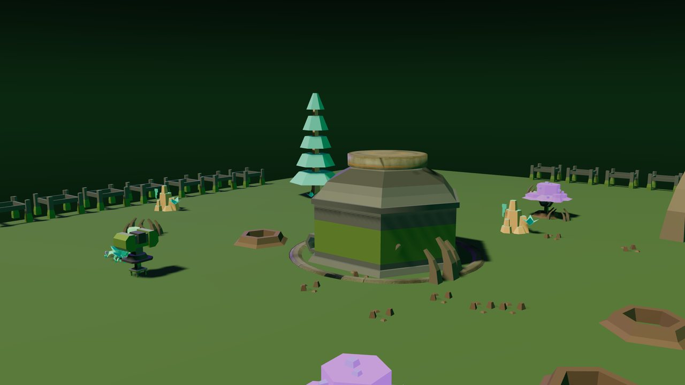 | 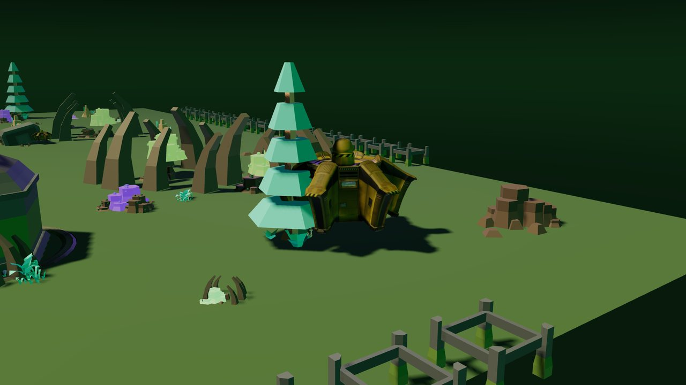 |
| `station` — domes and spore vents | `wreck` — the crashed lab |

## 3. Emberfall Foundry — keep the line running

An extraction site that never shut down. Black basalt, molten seams, ash in the
air, and the Cinder Yard power station standing beyond the east wall with its own
scanned surfaces.

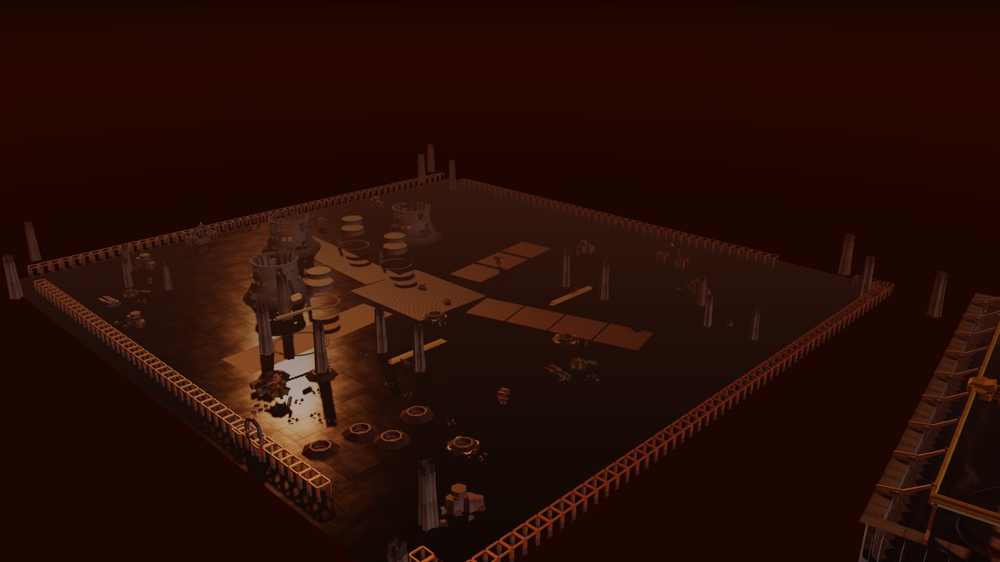

*`overview` — the foundry yard under a furnace key light: smelter towers, ore
silos, the drill rig, gantry cranes, and the plant to the east.*

| Beat | Where | What it is for |
| --- | --- | --- |
| **Smelter line** | centre | Three smelter towers venting over the yard; the ore silos and their drum tops. |
| **Yard** | south | Gantry cranes, cover stacks, barrels — the open ground the waves cross. |
| **Drill rig** | north | The magma drill on its pad, arm sweeping, crown turning. |
| **Slag pools** | east / west | Craters with molten plates glowing through them. The only light that comes from below. |
| **The plant** | east, beyond the wall | The Cinder Yard power station: 285 meshes, 65 scanned maps, the reason this world looks expensive. |

| | |
| --- | --- |
| 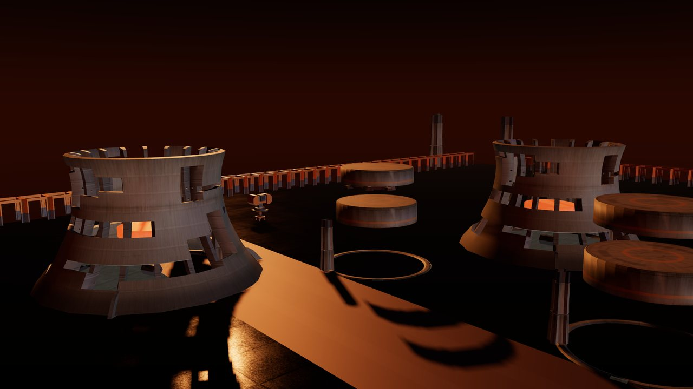 | 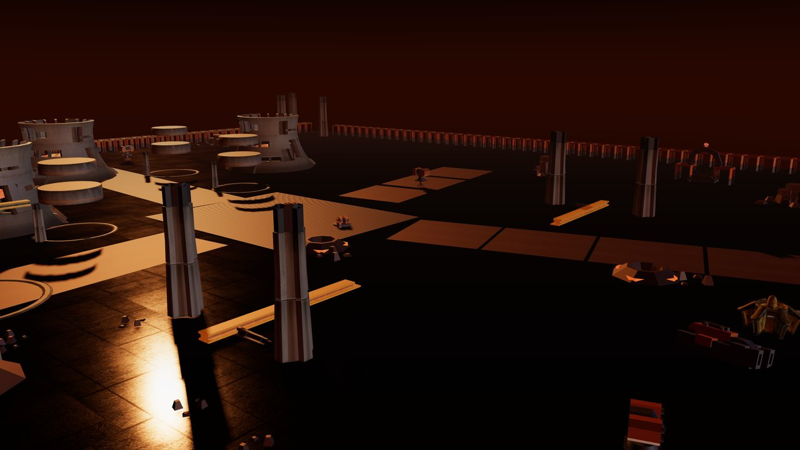 |
| `smelters` — the venting tower line | `yard` — cranes and cover stacks |
| 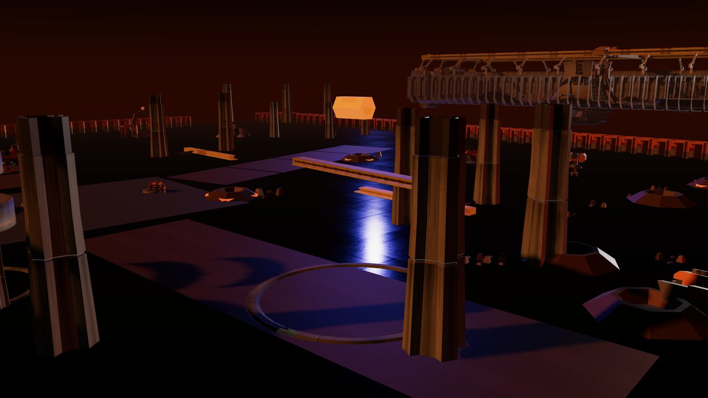 | 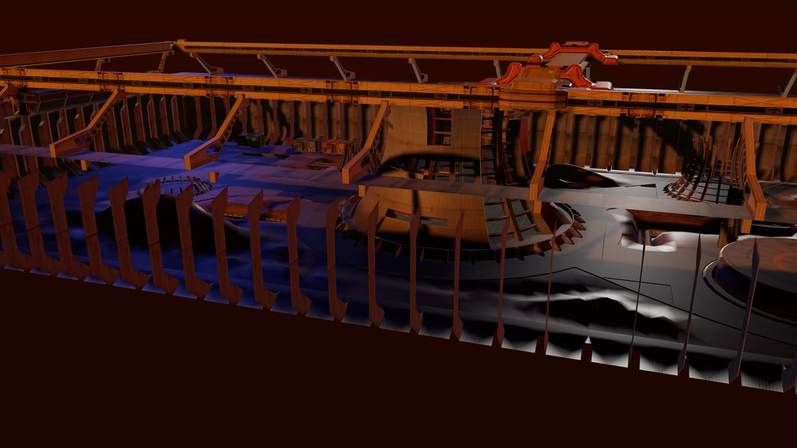 |
| `drill` — the magma drill rig | `plant` — the Cinder Yard station, scanned maps at close range |

## 4. Why they look like this

The palette is nine tokens — near-black voids, graphite panels with a cool
hairline, and exactly three luminous colours: **amber** (warning and heat),
**cyan** (power and information) and **violet** (alien). Nothing is bright by
accident. A surface is either structure (low saturation, matte) or energy (fully
saturated, emissive); there is no third category, which is what keeps a night
scene readable at mobile brightness.

What the three worlds do with those tokens differs, and the difference is
authored once in `src/worlds/themes.js` and once in
`game/scripts/worlds/world_mood.gd`:

| | Frostline Relay | Verdant Bloom | Emberfall Foundry |
| --- | --- | --- | --- |
| Key light | polar blue | hot green-white sun | furnace orange |
| Fill | ice blue from the east | moss green from the east | molten orange from below |
| Rim | aurora cyan from the north | violet spore light from the north | ash violet from the north |
| Sky / fog | deep teal, dense | forest green, denser | brown-black, densest |
| Kit grade | cold steel, cyan accent | mossy steel, amber trim | scorched metal, hot accent |
| Organics | — | lerped 10% toward the world's moss tone | — |

Three lighting rules apply to all of them:

1. One key from the south-west, low enough to throw 20–30 m shadows. It is the
   only shadow caster, and its colour is the world's signature.
2. One fill from the east, at roughly a third of the key's intensity, marking the
   edges that face away from the key.
3. One rim from the north — the accent colour arrives from the direction of the
   mission's landmark (the uplink, the fallen drone, the plant), so the light
   itself tells you where the objective is.

## 5. The worlds move

A static outpost reads as a diorama, so every district has moving parts authored
as animation clips on the real meshes:

- **Frostline** — dishes spin and sweep, the relay masts' bands bob, cryo collars
  turn, ice crystals pulse on offset phases, the frozen hauler's tender sways.
- **Verdant** — the bio domes' crowns turn and their overgrowth sways, spore vents
  pulse, canopies sway on their own phase, mushroom rings breathe, moss drapes
  swing.
- **Emberfall** — smelter glow bands spin, flues vent, silo drum tops turn, the
  drill crown spins and its arm sweeps, slag pools pulse, crane beams bob.

That is **61 / 156 / 31 clips**, one `AnimationMixer` per world in the viewer and
exported as glTF animations inside each staged GLB. Clip tracks are named
`<Instance>__<Part>`, so five identical sensor towers animate independently, and
the gate fails the build if a rule targets a part that does not exist.

The full asset inventory is [`ASSET_LIST.md`](ASSET_LIST.md); the surface and
verification record is [`PBR_AND_VERIFICATION.md`](PBR_AND_VERIFICATION.md).

## 6. How you verify it

Not by trusting the code. Four independent gates, described in
[`PBR_AND_VERIFICATION.md`](PBR_AND_VERIFICATION.md):

1. **Provenance ledger** — every file's SHA-256 against its licence and upstream
   URL, verified before any world is built.
2. **Asset-policy gate** — the capture run walks the live scene and fails if any
   mesh lacks `userData.realSource`, before a single photograph is written.
3. **Khronos validation** — each staged GLB is validated on the exact bytes Godot
   imports; all three report 0 errors and 0 warnings.
4. **Engine tests** — `mission_world_smoke.gd` builds all three worlds inside
   Godot, checks geometry, maps, clips, mood and field size per world, and proves
   no mesh exists outside the GLB; `verify_import.gd` proves the importer keeps
   the clips and sockets the manifest declares.
